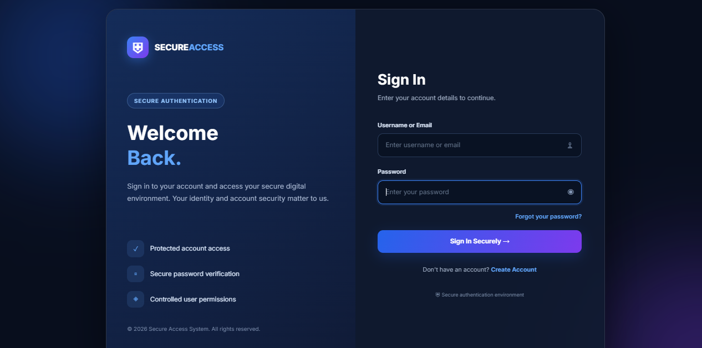
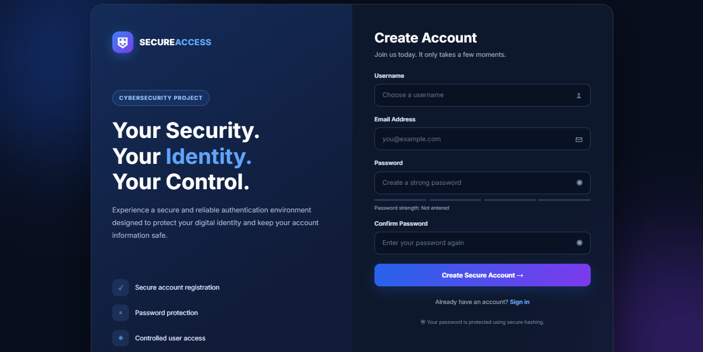
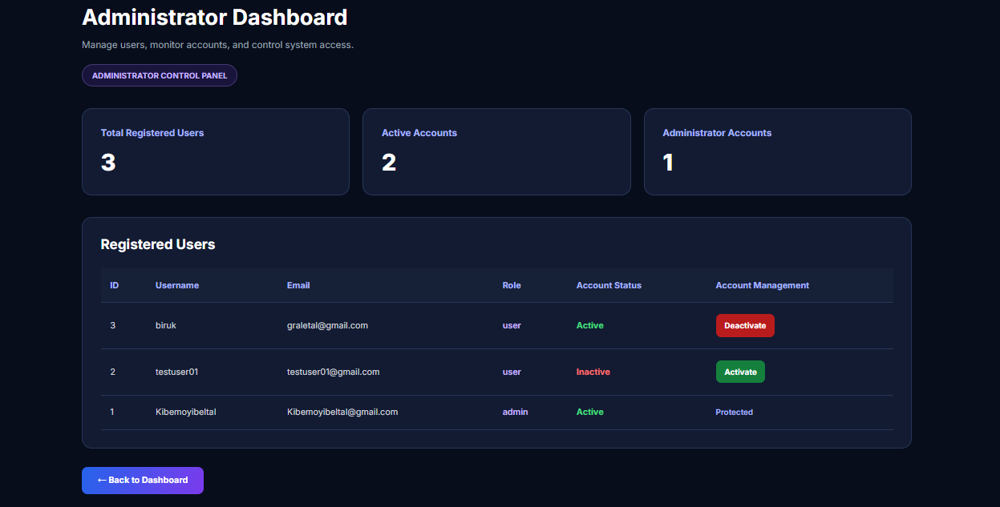

# Secure Login System

A PHP-based authentication system developed using PHP and MySQL.

## Features
- User registration and login
- Secure password hashing
- Forgot and reset password
- Change password
- Session management
- Login attempt protection
- Admin dashboard
- Role-based access control
- CSRF protection

## Technologies
- PHP
- MySQL
- HTML
- CSS
- JavaScript

## Screenshots

### Login Page

### Registration Page

### Admin Dashboard

## Developer
Yibeltal Kibemo
